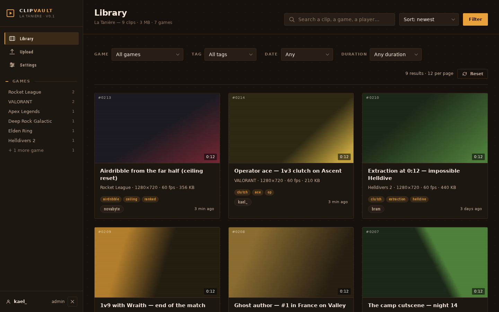
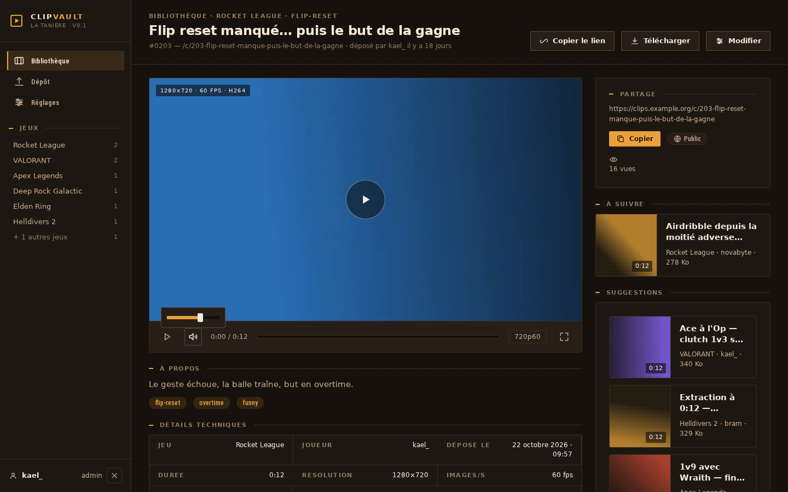
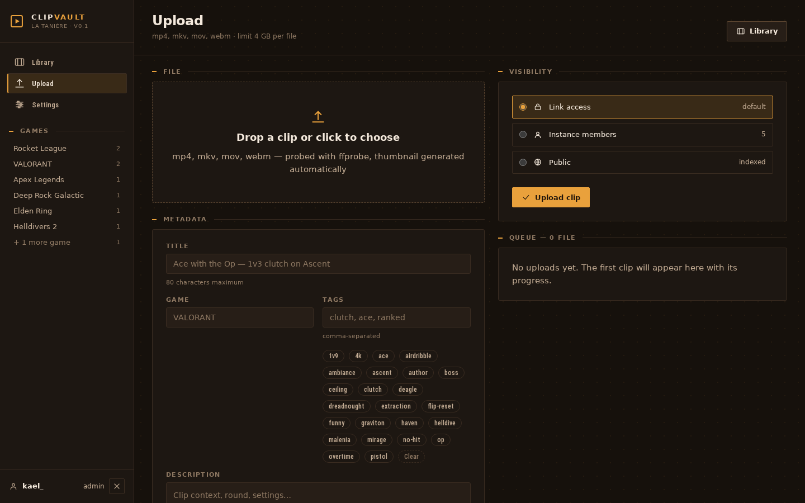
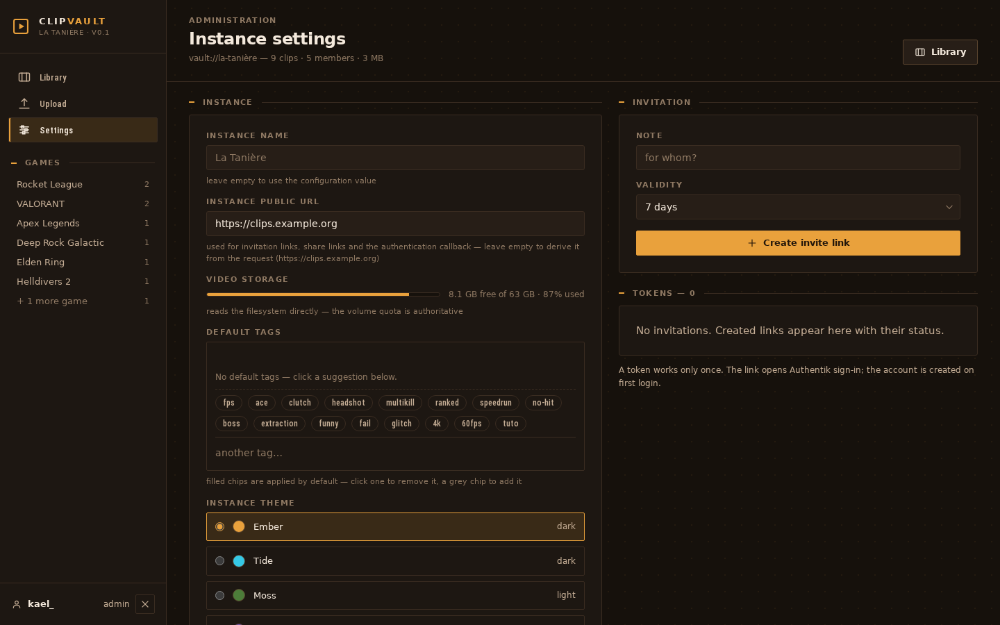
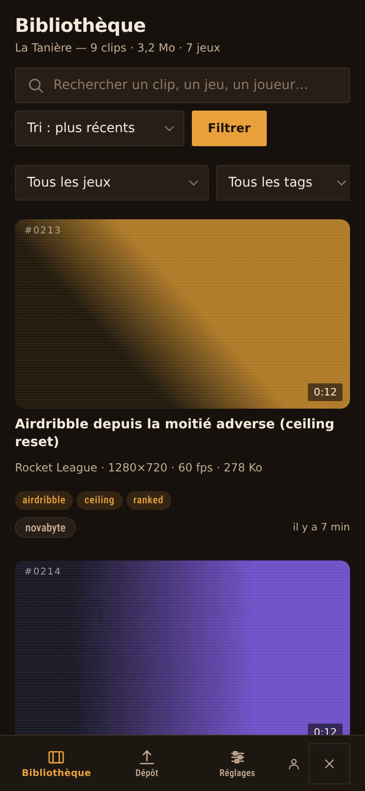
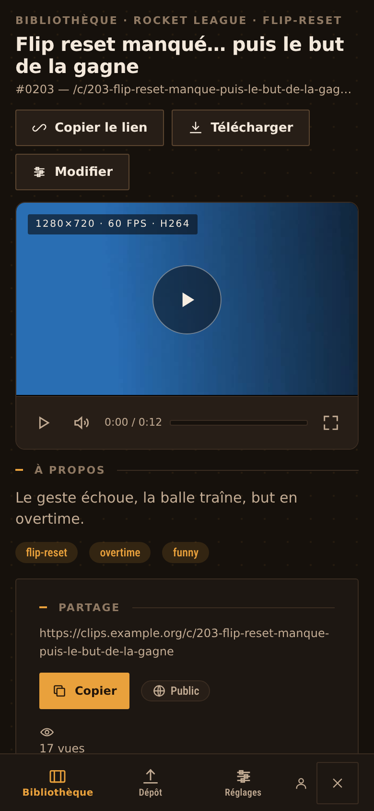

# ClipVault

Self-hosted hosting and sharing for game clips. A replacement for
[Fireshare](https://github.com/ShaneIsrael/fireshare) aimed at a small group of
players (5 to 50 accounts): drop a clip, watch it in the browser, share it with
a link.

- **SSO** through OIDC (Authentik, Keycloak, …), with an `admin` role taken from
  a group; a `dev` mode lets you try it without an identity provider.
- **Per-clip visibility**: `public`, `members` (signed-in accounts), `link`
  (unlisted, readable by anyone with the URL).
- **Direct playback** of the original file (`Range`, 206): no transcoding, a
  4 GB clip plays without being downloaded in full.
- **Technical metadata** extracted on the fly by `ffprobe` (resolution, fps,
  codec, size, duration) and thumbnails by `ffmpeg`.
- **Five themes**, chosen per instance from `/admin`: Ember, Tide, Moss, Aurora,
  Paper.
- **Tags**, search, sorting, pagination, single-use invites, view counter, public
  link expiry.
- **A single service dependency**: SQLite. Backup = copy `data/`.

The interface is in French — labels live in plain EJS templates, so translating
it is a find-and-replace away.

## Screenshots

Taken on the demo instance (`npm run db:seed` + `npm run media`), default Ember
theme: no real clip, every thumbnail is a video generated by `ffmpeg`.





| Upload | Instance settings |
| --- | --- |
|  |  |

| Library (mobile) | Player (mobile) |
| --- | --- |
|  |  |

## Stack

Node 22 · TypeScript · Fastify 5 · server-rendered EJS · SQLite
(`better-sqlite3`) · `ffmpeg`/`ffprobe` · hand-written CSS, no front-end
framework and no build step.

## Getting started

```bash
cd server
npm install
npm run db:seed        # demo database: 5 accounts, 14 clips
npm start              # http://localhost:8099
```

For development: `npm run dev` (hot reload); `npm run build` runs a full
`tsc --noEmit`.

Configuration is environment-based — see [`server/.env.example`](server/.env.example)
and [`server/README.md`](server/README.md) for the details (TLS-terminating
proxy, `TRUST_PROXY`, OIDC, quotas, importing existing videos, post-deploy
checks).

## Design

The reference design (7 screens, 5 themes) lives in [`design/`](design/): open
`design/index.html` in a browser. [`mockups/`](mockups/) keeps the three
variants compared blind before settling on "Vault Ledger".

## Security

The model is documented in [`server/README.md`](server/README.md): `SameSite`
plus an `Origin` check instead of per-form CSRF tokens, `TRUST_PROXY` as a
number of trusted proxies (never `true`), `COOKIE_SECURE` behind a
TLS-terminating proxy, hardened container (read-only root, capabilities
dropped, `ffmpeg` time-boxed). To report a vulnerability, see
[`SECURITY.md`](SECURITY.md).

## License

[MIT](LICENSE).
